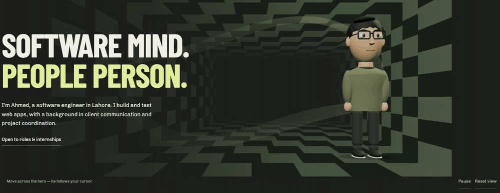
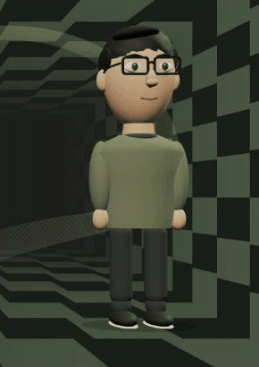

# Ahmed M. — Portfolio

A personal portfolio for software engineering, software QA and project coordination roles. Four project films sit alongside requirements, implementation notes, test evidence and source links. An original interactive 3D character and checkerboard room introduce the work.

[Live portfolio](https://ahmed-m-portfolio.vercel.app/) · [GitHub](https://github.com/iahmedmalik) · [LinkedIn](https://www.linkedin.com/in/ahmedmalik494/) · [Email](mailto:ahmedmalikk494@gmail.com)

## The studio

[](https://ahmed-m-portfolio.vercel.app/)

A recording of the live site, including the original 3D avatar and pointer-responsive checkerboard and contour artwork. Open the portfolio to move the cursor yourself, pause motion, or reset the view.

### The illustrated avatar

[](https://ahmed-m-portfolio.vercel.app/)

Built from original procedural geometry in [create-avatar.ts](lib/create-avatar.ts), with the interactions in [HeroScene.tsx](components/HeroScene.tsx). This is a stylized character, not a photographic likeness. The README previews are looping GIFs; the live version responds to your cursor. Reduced-motion preferences pause the live scene by default.

## Run locally

Use Node.js 24 LTS and npm. No API keys or environment variables are required.

```sh
npm ci
npm run dev
```

Open http://127.0.0.1:3107.

```sh
npm test
npm run build
npm run start
```

`npm run build` includes TypeScript checking. Run `npm run typecheck` separately after Next.js has generated its route types.

## Deploy on Vercel

Import this repository as a Next.js project. Use the repository root as the Root Directory, Node.js 24.x, `npm ci` as the install command, and `npm run build` as the build command. Leave Output Directory at the framework default. There are no secrets, database services or external font downloads to configure.

All required fonts, project screenshots and MP4 films are committed under `public/`. The hero loads Three.js on the client, pauses offscreen, respects reduced motion and provides a static fallback when WebGL is unavailable. Content and contact links remain usable without the 3D scene.

## Where to edit

| File | Purpose |
| --- | --- |
| `lib/content.ts` | Projects, skills, test evidence, experience and profile links |
| `app/page.tsx` | Page structure and alternating project showcases |
| `app/globals.css` | Self-hosted fonts, colours, artwork and responsive layout |
| `components/HeroScene.tsx` | Checkerboard room, cursor response and motion controls |
| `lib/create-avatar.ts` | Original procedural character geometry |
| `components/FilmPlayer.tsx` | Accessible project films with playback controls |
| `components/ExperienceSelector.tsx` | Keyboard-accessible company selector |
| `components/QAShowcase.tsx` | Manual testing sample and execution evidence |
| `components/SectionDepth.tsx` | Decorative perspective studies |
| `components/Contact.tsx` | Profile links and copy-email control |
| `tests/content.test.mjs` | Required links, media files and evidence checks |

## Project films

The four 1080p motion films were produced in a separate Remotion workspace. FlowPlan and QueueCare use demo-site screenshots; CommitteeKeeper and PulseMetrics use local runs with demo data. Film diagrams reflect each app’s own design and data. PulseMetrics is a local prototype, as labelled on the site.

## Content and attribution

Projects are personal portfolio work. The page links directly to source, requirements and test reports so visitors can inspect the evidence. Work history and education follow Ahmed's CV (Computer Science graduate, UET Lahore); no unverified certification is claimed. The character, checkerboard scene, contour artwork and football illustration are original code-built artwork. Self-hosted Chivo and Barlow Condensed fonts are distributed under the SIL Open Font License; notices are included with the font assets.
